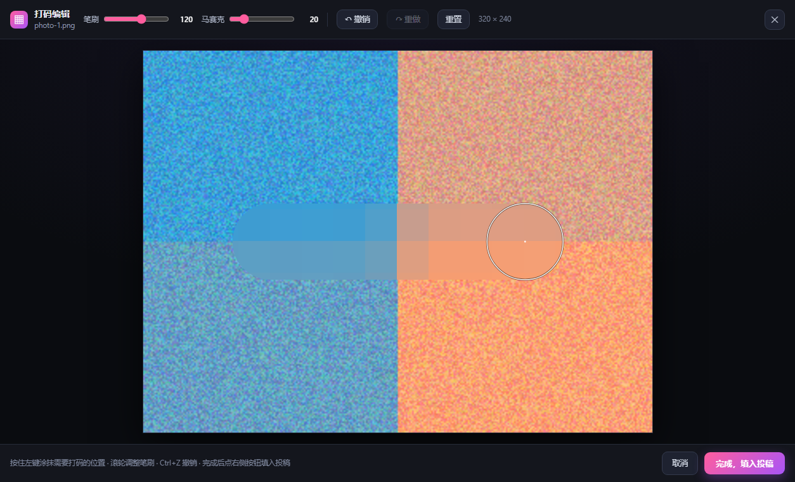
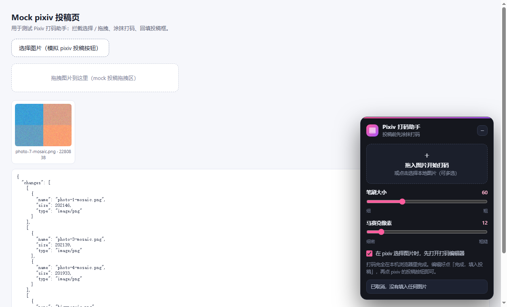

# Pixiv 打码助手 · Pixiv Mosaic Helper

[](LICENSE)
[](https://github.com/lazyno1/pixiv-mosaic-helper/releases/latest)
[](https://github.com/lazyno1/pixiv-mosaic-helper)
[](https://github.com/lazyno1/pixiv-mosaic-helper)

给 pixiv 投稿图片加马赛克的浏览器扩展：选择或拖入图片后先进入打码编辑器，涂好马赛克再一键填回投稿框，继续正常投稿即可。

A Manifest V3 extension for Edge / Chrome that intercepts image uploads on pixiv, lets you paint mosaic over the areas you want to hide, and injects the processed file back into the upload form. Everything runs locally in the browser — no image ever leaves your machine.



## 功能

- **接管投稿上传**：在 pixiv 投稿页点击「选择图片」时先打开打码编辑器，原图不会直接进入投稿框。
- **多种导入方式**：选择文件、把图片拖到右下角面板、或直接拖到投稿页。
- **实时马赛克涂抹**：按住左键涂抹，预览即时可见；笔刷为圆头，可来回叠加。
- **两个可调参数**
  - 笔刷大小：4–200 屏幕像素（`[` / `]` 或滚轮微调）；
  - 马赛克像素：2–100 原图像素，每笔画下时记录当时的值，之后调整不影响已画笔迹。
- **撤销 / 重做 / 重置**：按钮或 `Ctrl+Z`、`Ctrl+Shift+Z` / `Ctrl+Y`。
- **多图队列**：一次选择或拖入多张时逐张编辑，全部完成后一次性回填投稿框。
- **保持格式与尺寸**：JPEG / PNG / WebP 按原格式重新编码（质量 0.92），其它格式转 PNG；长边超过 4096 像素自动等比缩小，编辑器顶部会显示最终尺寸。
- **记住偏好**：笔刷、马赛克像素、自动拦截开关存在 `chrome.storage.local`。
- **与页面样式隔离**：全部 UI 放在 Shadow DOM 里，不受 pixiv 样式影响，也不会污染页面。



## 安装

### 直接下载（推荐）

到 [Releases](https://github.com/lazyno1/pixiv-mosaic-helper/releases/latest) 下载 `pixiv-mosaic-helper.zip`，解压后按下面的开发者模式步骤加载其中的 `extension/` 文件夹。

### Edge / Chrome（开发者模式）

1. 下载或克隆本仓库。
2. 打开 `edge://extensions/` 或 `chrome://extensions/`。
3. 打开「开发人员模式」。
4. 点「加载解压缩的扩展」，选择本仓库的 **`extension/`** 文件夹（不是仓库根目录）。
5. 打开 pixiv 投稿页（如 `/artworks/new`），右下角出现「▦」按钮即安装成功。

### 打包发布

扩展没有构建步骤，`extension/` 目录本身就是发布内容：

```powershell
# Windows
Compress-Archive -Path extension -DestinationPath pixiv-mosaic-helper.zip
```

```bash
# macOS / Linux
zip -r pixiv-mosaic-helper.zip extension
```

上架 Edge 加载项 / Chrome 应用商店需要开发者账号与打包审核，与本地加载无关。

## 使用

### 方式一：点 pixiv 的「选择图片」

1. 在投稿页点击上传区域选择图片 —— 扩展会先打开打码编辑器。
2. 涂抹需要遮挡的位置，按需调整笔刷与马赛克像素。
3. 点「完成，填入投稿」，回到投稿页继续填写标题、标签并提交。

### 方式二：从面板拖拽

1. 点右下角「▦」打开面板（投稿页会自动展开）。
2. 把图片拖到「拖入图片开始打码」区域，或点击该区域选择文件。
3. 编辑完成后点「完成，填入投稿」。

### 快捷键

| 操作 | 快捷键 |
| --- | --- |
| 撤销 | `Ctrl+Z` |
| 重做 | `Ctrl+Shift+Z` 或 `Ctrl+Y` |
| 关闭编辑器（取消本次编辑） | `Esc` |
| 笔刷变粗 / 变细 | `]` / `[`，或鼠标滚轮 |

## 工作原理

```
用户选择/拖入图片
      │
      ▼
content.js 在 window 捕获阶段拦截 file input 的 change 与页面 drop
      │  清空原 input，避免原图被上传
      ▼
editor.js（Shadow DOM 全屏编辑器）
      │  每个笔画 = 图像坐标点列 + 半径 + 马赛克块大小
      │  按笔刷包围盒局部降采样→放大→圆刷遮罩叠加到画布
      ▼
导出：按原分辨率重绘 + 逐笔叠加马赛克 → toBlob → File
      │
      ▼
回填：DataTransfer 写入 input.files → 派发一次 change
      │  找不到投稿框时依次退化为：合成 drop 事件 → 下载文件并提示
      ▼
pixiv 前端照常完成上传
```

马赛克块按全局网格对齐（`x0 = floor(minX / block) * block`），预览与导出使用同一套几何计算，所以看到的效果与最终文件一致。

## 隐私

- 只申请 `storage` 权限，以及仅在 `https://www.pixiv.net/*` 与 `https://*.pixiv.net/*` 注入内容脚本的权限。
- 不采集、不上报任何数据；图片只在当前标签页的 Canvas 中处理，不访问第三方服务器。
- 不使用远程代码、不注入第三方脚本；`extension/` 内即全部逻辑，可逐行审计。

## 已知限制

- 扩展基于通用的 `input[type=file]`（图片类型）与 `drop` 文件监听，不依赖 pixiv 的具体 DOM 结构；如果 pixiv 改版后无效，可点工具栏图标强制显示面板，或直接把图拖进面板。
- 如果投稿页阻止程序化写入文件，扩展会把处理后的图片下载到本地并提示，不会静默丢失。
- 超长边图片会被缩到 4096，这是为了在浏览器内存与上传体积之间取平衡。
- 目前未在 pixiv 官方页面上做逐版本的回归验证，欢迎提交 Issue 说明页面结构变化。

## 项目结构

```
extension/                 # 扩展源码（加载这个目录）
  manifest.json
  background.js            # 默认设置 + 工具栏图标切换面板
  content/
    styles.js              # Shadow DOM 样式
    editor.js              # 全屏打码编辑器（Canvas、撤销、导出）
    content.js             # 面板、上传拦截、回填投稿框
  icons/                   # 16/32/48/128 图标

tools/
  make-icons.py            # 重新生成图标
  requirements.txt         # 图标脚本依赖（Pillow、numpy）

test/
  mock-pixiv.html          # 本地模拟投稿页
  run-test.mjs             # 基于 CDP 的端到端测试

docs/screenshots/          # README 展示图
```

## 开发与测试

需要 Node.js 20+ 与现代 Edge / Chrome，无 npm 依赖。

```bash
# 语法检查
node --check extension/content/editor.js

# 端到端测试：本地起 mock 投稿页 + headless 浏览器加载真实扩展
node test/run-test.mjs
```

- 测试会在 `127.0.0.1:8123` 提供 mock 页，并用 `--host-resolver-rules` 把测试域名 `www.pixiv.test` 指向本地（避开 HSTS），再通过 CDP 驱动 headless 浏览器。
- 默认自动探测 Edge / Chrome / Chromium；也可用环境变量指定：

  ```powershell
  $env:EDGE_PATH = 'C:\Program Files (x86)\Microsoft\Edge\Application\msedge.exe'
  node test/run-test.mjs
  ```

- 覆盖 38 项断言：拦截时不泄漏原图、涂抹区域确实被打散、未涂抹区保留细节、只派发一次 `change`、取消不写入、多图队列一次性回填、超 4096 大图缩放后仍打码、拖拽导入、面板与编辑器滑块双向同步等。
- 运行截图输出到 `test/screenshots/`（已加入 `.gitignore`）。
- Windows 上无头浏览器需要创建命名管道；在受限沙箱/受限启动器里可能以 `0x80000003` 退出，请在普通终端运行。
- 需要重新生成图标时：`python tools/make-icons.py`（依赖见 `tools/requirements.txt`）。

## 许可证

[MIT](LICENSE)
